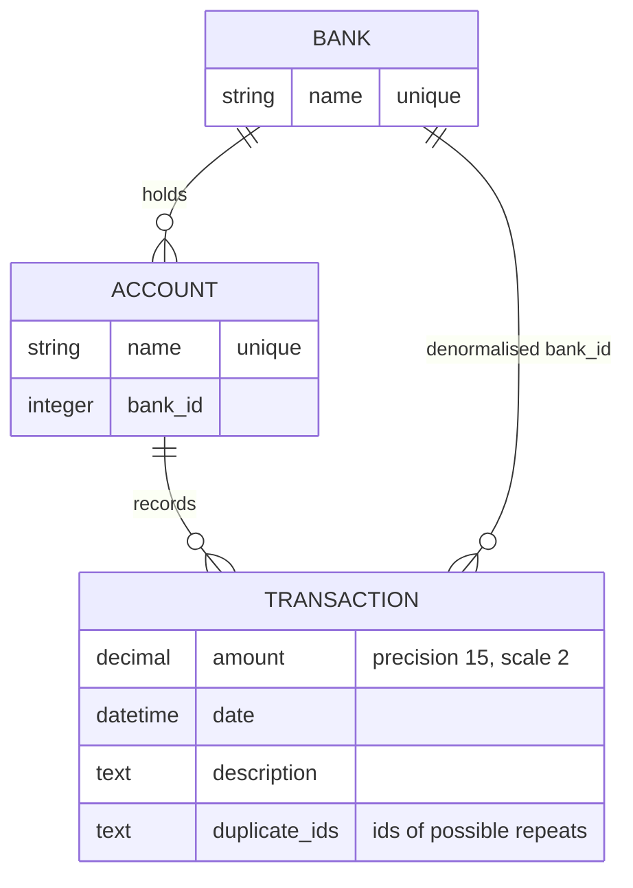

# Account Management API

A Rails JSON API for modeling banks, customer accounts and account transactions. Accounts live inside a bank, transactions live inside an account, and every nested route resolves the account through the bank in the URL, so a request cannot reach another bank's data by changing one id. Each new transaction is checked against recent ones on the same account and flagged when it looks like a repeat.

Built with Ruby 3.4, Rails 8.1 (API mode), SQLite and active_model_serializers.

## Domain model



Bank and account names are unique, enforced by validations and by unique indexes. A transaction needs an amount and a date; the description is optional. Banks and accounts that still have dependants cannot be deleted.

## API

All routes are under `/api/v1` and return JSON.

| Method | Route | Purpose |
| --- | --- | --- |
| `GET` | `/banks` | List banks |
| `POST` | `/banks` | Create a bank (`name`) |
| `PATCH` | `/banks/:id` | Rename a bank |
| `DELETE` | `/banks/:id` | Delete a bank without accounts |
| `GET` | `/banks/:bank_id/accounts` | List the bank's accounts |
| `POST` | `/banks/:bank_id/accounts` | Open an account (`name`) |
| `GET` | `/banks/:bank_id/accounts/:id/amount` | Sum of the account's transaction amounts |
| `GET` | `/banks/:bank_id/accounts/:account_id/transactions` | List the account's transactions |
| `POST` | `/banks/:bank_id/accounts/:account_id/transactions` | Record a transaction (`amount`, `date`, optional `description`) |
| `PATCH` | `/banks/:bank_id/accounts/:account_id/transactions/:id` | Change any of `amount`, `description`, `date` |
| `DELETE` | `/banks/:bank_id/accounts/:account_id/transactions/:id` | Delete a transaction |

`GET /up` is the Rails health check.

Parameters can be sent as a JSON body or as form fields. Validation failures return `422` with `{"errors": [...]}`. A missing parameter (`422`) or an unknown record (`404`) returns `{"errors": "..."}` with a single message.

### Walkthrough

These requests and responses were captured from the Docker setup below, starting from the seed data.

Create a bank and open an account in it:

```http
POST /api/v1/banks
Content-Type: application/json

{"name": "Juniper Trust"}
```

```json
201 Created
{"id": 3, "name": "Juniper Trust"}
```

```http
POST /api/v1/banks/3/accounts
Content-Type: application/json

{"name": "Escrow"}
```

```json
201 Created
{"id": 4, "name": "Escrow", "bank_id": 3}
```

Record the same deposit twice. The second one comes back flagged, pointing at the first:

```http
POST /api/v1/banks/3/accounts/4/transactions
Content-Type: application/json

{"amount": "980.00", "description": "Deposit from buyer", "date": "2026-11-09"}
```

```json
201 Created
{
  "id": 5,
  "amount": "980.0",
  "date": "2026-11-09T00:00:00.000Z",
  "description": "Deposit from buyer",
  "flag_transactions": [
    {"id": 4, "amount": "980.0", "date": "2026-11-09T00:00:00.000Z"}
  ]
}
```

A `PATCH` only needs the fields that change, and the flag set at creation is kept:

```http
PATCH /api/v1/banks/3/accounts/4/transactions/5
Content-Type: application/json

{"description": "Deposit from buyer (second wire)"}
```

```json
200 OK
{
  "id": 5,
  "amount": "980.0",
  "date": "2026-11-09T00:00:00.000Z",
  "description": "Deposit from buyer (second wire)",
  "flag_transactions": [
    {"id": 4, "amount": "980.0", "date": "2026-11-09T00:00:00.000Z"}
  ]
}
```

```http
GET /api/v1/banks/3/accounts/4/amount
```

```json
200 OK
{"amount": "1960.0"}
```

Errors:

```http
DELETE /api/v1/banks/3
```

```json
422 Unprocessable Content
{"errors": ["Cannot delete record because dependent accounts exist"]}
```

```http
GET /api/v1/banks/1/accounts/4/amount
```

```json
404 Not Found
{"errors": "Record(s) not found: Account"}
```

Account 4 exists, but not in bank 1, so the lookup fails instead of crossing banks.

## How duplicate flagging works

Before a transaction is created, the model looks for transactions on the same account with the same amount and description created in the last minute (`Transaction::DUPLICATE_WINDOW`). Their ids are stored in `duplicate_ids`, and the serializer expands them into `flag_transactions`.

- It is a review flag. Nothing is rejected, because a repeated payment can be legitimate.
- It runs only on create. Editing a transaction later does not rewrite its flags.
- The query uses plain Active Record conditions, so it does not depend on SQLite-specific SQL.

## Design notes

- **One generic controller.** `Api::V1::BaseController` implements index, create, update and destroy against `model`, `collection`, `resource` and `permitted_params`. Each resource controller overrides only what differs (for example the nested scoping in `TransactionsController`) and opts into routes with the `actions` macro from `BaseHandler`.
- **Scoping through the parent.** Transactions are always loaded through `account.transactions`, and the account is found with both `bank_id` and `id`. Cross-bank ids return `404`.
- **Money precision.** `amount` is a `decimal(15, 2)`. SQLite stores decimals as floating point, so without a scale `SUM(amount)` drifted (91.04 came back as 91.03999999999999). With a scale, Active Record rounds reads and sums to cents.
- **Guarded deletes.** `dependent: :restrict_with_error` turns a delete that would orphan records into a `422` with a reason, instead of a foreign-key error.

## Running it

### With Docker (recommended)

Requires Docker with Compose.

```bash
docker compose up --build
```

On first start the container runs `bin/rails db:prepare`, which creates the SQLite database in a named volume, loads `db/schema.rb` and the seed data. The API is then at `http://localhost:3000/api/v1`:

```bash
curl http://localhost:3000/api/v1/banks
# [{"id":1,"name":"Harbor Savings"},{"id":2,"name":"Northwind Credit Union"}]
```

Tests and lint run in the same image:

```bash
docker compose run --rm --no-deps api bundle exec rspec
docker compose run --rm --no-deps api bundle exec rubocop
```

Remove the containers and the database volume with `docker compose down -v`.

### Locally

Requires Ruby 3.4.12 (see `.ruby-version`) and Bundler. The `sqlite3` gem ships its own SQLite.

```bash
bundle install
bin/rails db:prepare   # creates storage/development.sqlite3 and seeds it
bin/rails server
```

```bash
bundle exec rspec      # model, controller, request and seed specs
bundle exec rubocop    # rubocop-rails-omakase
bundle exec bundle-audit check --update
```

### Configuration

| Variable | Default | Purpose |
| --- | --- | --- |
| `PORT` | `3000` | Puma port |
| `RAILS_MAX_THREADS` | `5` | Puma threads and database pool size |
| `RAILS_ENV` | `development` | Rails environment |
| `SECRET_KEY_BASE` | none | Required only when running with `RAILS_ENV=production`; the project ships no encrypted credentials |

## Project structure

```text
app/
├── controllers/api/v1/   # BaseController plus bank, account and transaction endpoints
├── controllers/concerns/ # Error rendering and the actions macro
├── models/               # Bank, Account, Transaction (duplicate flagging lives here)
└── serializers/          # Response shapes
db/
├── migrate/              # Schema history
└── seeds.rb              # Demo banks, accounts and a flagged repeat
spec/
├── controllers/api/v1/   # Controller-level behaviour
├── requests/             # End-to-end HTTP behaviour
├── models/               # Associations and validations
└── db/                   # Seed idempotency
```

## Current limits

- There is no authentication or ownership model; any client can read and change any bank.
- `amount` is a signed number. There is no debit/credit direction or immutable ledger, so the amount endpoint is a sum, not a reconciled balance.
- Transaction lists are not paginated or filterable.
- Banks can be renamed and deleted, but accounts can only be listed and created.
- SQLite suits a single-node deployment. Running several app instances would need a server database.

## License

MIT. See [LICENSE](LICENSE).
